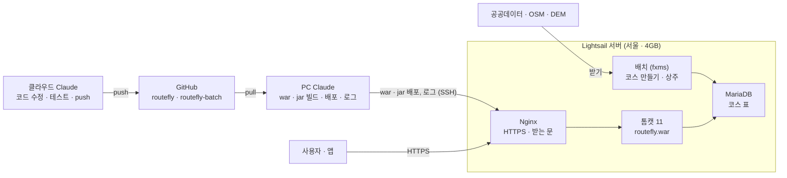

# routefly 공개 서버 전환 검토 보고서

2026-10-11 · 홍TV님 요청으로 작성(원본: claude.ai 문서 "routefly 공개 서버 전환 검토 보고서"). 설치 명령은 [deploy-lightsail.md](deploy-lightsail.md).

결론: routefly 를 Lightsail 에 올리는 데 배치까지 포함해 첫해 약 320달러(월 27달러 안팎)가 들고, 젠킨스는 필요 없습니다. 서버를 열기 전에 상표 검색과 위치정보법 확인을 먼저 하는 것을 권합니다.

| 검토 항목 | 결론 |
| --- | --- |
| 협업 방식 | 코드는 클라우드 Claude 그대로, 배포 · 로그는 PC Claude 가 서버로. 배치도 서버에서 상주 실행. PC 를 꺼도 서비스 · 코스 갱신이 돈다 |
| 비용 | 서버 4GB 월 24달러(배치 메모리 때문) + 스냅샷 월 1~3달러 + 도메인 연 2만원 안팎. 스토어 25달러(한 번), 상표 9 · 42류 약 49만원(10년) |
| 배포 프로그램 | 젠킨스 불필요. 배포 스크립트 → 익숙해지면 GitHub Actions(무료) |
| 리눅스 | 명령 20개 남짓, 월 30분 관리. 백업 · 인증서 · 보안 업데이트는 자동으로, 설치 · 문제 해결은 PC Claude 가 |
| 상표권 | 스토어 출시에 필수는 아님. KIPRIS 검색 후 출시 무렵 9 · 42류 셀프 출원 권장 |
| 주의 | "내 주변 코스" 검색이 위치 주변 값을 서버로 보내므로 위치정보법 신고 대상인지 문의 필요 |

추천 순서: 상표 · 도메인 확인 → 위치정보지원센터 문의 → AWS 계정 · 서버 설치 → 첫 배포 · 앱 주소 고정 → 상표 출원 → (선택) 플레이스토어 → (나중에) 자동 배포.
요금 · 수수료는 웹 검색으로 확인한 값이고 법률 판단이 아니므로, 결제 · 출원 전에 공식 화면에서 다시 확인해야 합니다.

## 1. 바뀌는 협업 방식

코드를 고치는 쪽(클라우드 Claude)은 그대로이고, 배포 · 운영 확인이 홍TV님 PC 에서 Lightsail 서버로 옮겨 갑니다.
배치(routefly-batch)도 서버로 옮겨, PC 를 꺼도 코스 자료까지 서버에서 돌게 합니다. 대신 서버는 4GB 요금제가 필요합니다.

사용자는 Nginx 로만 들어오고, 서버에 손을 대는 것은 PC Claude(배포) 하나이고, 배치는 서버 안에서 공공데이터 · OSM 을 받아 같은 DB 에 바로 넣습니다.

| 일 | 지금 | Lightsail 이후 |
| --- | --- | --- |
| 코드 수정 · 테스트 · push | 클라우드 Claude | 클라우드 Claude (그대로) |
| 웹 배포 | PC 의 Claude: pull → 이클립스 F5 (localhost:8080) | PC 의 Claude: war 빌드 → 서버로 복사 (나중에는 GitHub Actions 가 자동으로, 3장) |
| 개발용 화면 확인 | PC 톰캣 | PC 톰캣 (그대로 - 서버에 올리기 전 확인용) |
| 실제 사용자 화면 · 로그 | PC 톰캣 + Cloudflare 터널(주소가 켤 때마다 바뀜) | 서버 `https://routefly.kr/routefly/` · `/opt/tomcat/logs` |
| DB | PC MariaDB 하나 | 서버 MariaDB(서비스 · 배치가 함께). PC MariaDB 는 개발 · 테스트용 |
| 배치(코스 만들기) | PC (fxms, 5분마다 `--once`) | 서버 상주 실행(systemd), 같은 서버 DB 에 바로 넣음. PC 는 개발 · 테스트 실행만 |
| 앱 `server.url` | 터널 주소(바뀌면 앱을 다시 빌드) | 고정 주소 한 번 넣고 끝 |
| PC 를 꺼도 되나 | 안 됨 (서비스가 멈춤) | 됨 (서비스는 서버에서 돎) |

### 배치를 서버로 옮길 때

저장소에 리눅스용 상주 실행 스크립트(`bin/routefly-batch.sh` · `bin/.setenv.sh`, 설치 자리 `/app/routefly/batch`)가 이미 있어 코드를 바꿀 일은 거의 없습니다. 옮겨야 하는 것은 파일과 설정입니다.

| 옮길 것 | 어떻게 |
| --- | --- |
| 실행 jar | PC 에서 `bin\build.ps1` 로 만든 `deploy/lib/*.jar`(fxms jar 포함)를 서버로 복사. jar 는 윈도우 · 리눅스 구분 없음. fxms jar 는 저장소에 없으므로 서버에만 둠 |
| 설정 | `batch.properties` · `databases.xml` 을 서버용으로 새로(경로는 리눅스 경로, DB 는 `127.0.0.1`, 배치용 쓰기 계정) |
| 받은 자료 `data/` | 산림청 ZIP · 국립공원 SHP · CSV · komount · 두루누비 GPX · 내 GPX 를 `scp` 로 한 번 올림. 새 자료도 서버에 올려야 함 |
| 캐시 `cache/osm` · `cache/dem` | 같이 올리면 Overpass 를 처음부터 다시 받지 않음(osmBike 다시 받기는 1시간 넘게 걸림) |
| 실행 방식 | 윈도우 작업 스케줄러 + `--once` 대신 systemd 서비스로 상주 실행(`BatchDaemon`, 배치마다 주기 그대로) |
| 키 | V-World 는 키에 등록한 주소로만 동작 - `vworld.domain` 을 새 도메인으로, V-World 사이트에도 등록 |

메모리가 가장 큰 문제입니다. 배치는 `-Xmx1g`, 톰캣은 `-Xmx768m` 로 잡혀 있어 둘만 합쳐도 1.8GB 이고, 여기에 MariaDB · 리눅스가 더해집니다(둘은 수백 MB 로 추정).
2GB 서버에서는 배치가 돌 때 화면이 느려지거나 프로세스가 죽을 수 있어 4GB(월 24달러)를 권합니다. 디스크는 4GB 요금제가 80GB 이므로, PC 의 `data` · `cache` 폴더 크기를 먼저 재 봐야 합니다.

### 클라우드 Claude 와 PC Claude 의 새 역할

- 클라우드 Claude: 지금처럼 코드 · 테스트 · push. 서버에는 접속하지 않습니다(서버 키를 클라우드에 두지 않는 편이 안전).
- PC Claude: 서버 접속(SSH) · 웹 war · 배치 jar 배포, 로그 확인을 맡습니다. CLAUDE.md 5장의 "홍TV님 PC 의 Claude 가 할 것" 에 "서버 배포 · 서버 로그 확인" 이 더해집니다.
- 홍TV님: 서버 비밀번호 · 키 보관, 요금 확인, 도메인 · 스토어 계정 관리.

## 2. Lightsail 올리는 절차와 비용

배치까지 올리는 4GB 서버 · 도메인으로 첫해 약 320달러(월 27달러 안팎)이고, 플레이스토어를 더하면 25달러가 한 번 더 듭니다.

### 비용

| 항목 | 금액 | 주기 | 비고 |
| --- | --- | --- | --- |
| Lightsail 4GB (IPv4 포함) | 24달러 | 매달 | 2 vCPU · 80GB SSD · 전송 4TB. 꺼 둬도 청구됨. 웹만 올리면 2GB(12달러)로 충분 |
| 자동 스냅샷 | GB 당 월 0.05달러 | 매달 | 실제 쓴 만큼. 대략 월 1~3달러로 보임(추정) |
| 고정 IP | 0 | - | 인스턴스에 붙여 두면 무료, 떼어 두면 청구 |
| 전송량 초과(서울) | GB 당 0.13달러 | 넘을 때만 | 지도 타일은 우리 서버를 안 거쳐 4TB 를 넘기 어려움(배치가 받는 자료는 들어오는 트래픽이라 과금 없음) |
| 도메인 `.kr` (가비아) | 16,500원 | 해마다 | 첫해 할인가. 연장가는 확인 필요(약 2만원으로 알려짐) |
| 도메인 `.com` (Cloudflare) | 약 10.5달러 | 해마다 | 원가 그대로, 연장도 같은 값 |
| HTTPS 인증서 (Let's Encrypt) | 0 | - | 90일마다 자동 갱신 |
| Cloudflare Free | 0 | - | 붙일 때만 |
| GitHub Actions | 0 | - | routefly 는 공개 저장소라 무료 |
| Google Play 개발자 등록 | 25달러 | 한 번 | 스토어에 올릴 때만 |
| 상표 출원 · 등록 | 5장 | 10년 | 5장에서 |

비교: Lightsail 관리형 DB 는 가장 싼 것도 월 15달러이고 MariaDB 를 고를 수 없어, 서버에 MariaDB 를 직접 올리는 쪽이 낫습니다.
무료 체험(예전엔 3개월 무료, 2025-07 이후 가입 계정은 AWS 크레딧 방식으로 바뀌었다는 자료)은 가입할 때 공식 화면에서 확인해야 합니다.

### 절차

1. AWS 계정 만들기 → 루트 계정에 두 단계 인증(MFA) 켜기 → Billing 에서 월 40달러 예산 알림(AWS Budgets) 걸기
2. 도메인 사기(`routefly.kr` 또는 `.com` - 5장의 상표 조사와 함께 정함)
3. Lightsail 서울 · Ubuntu 24.04 · 4GB 인스턴스 + 고정 IP + 방화벽(22 · 80 · 443)
4. 서버 설치: Java 21 · MariaDB · 톰캣 11 · Nginx · certbot (`deploy-lightsail.md` 3~6장, PC Claude 가 SSH 로 진행)
5. PC DB 덤프 → 서버 DB, 웹 `config.properties` 작성(`site.baseUrl` 포함), V-World 에 새 도메인 등록. 배치는 /app/routefly/batch 에 jar · 설정 · data · cache 를 올리고 --once 로 하나씩 시험한 뒤 systemd 상주 서비스로 켜고, PC 작업 스케줄러는 끕니다(`deploy-lightsail.md` 9장)
6. war 배포 → `https://<도메인>/routefly/` 확인 → 자동 스냅샷 켜기
7. 앱 `server.url` 을 고정 주소로 바꿔 다시 빌드(한 번만)
8. 공개 전 법적 준비: 개인정보처리방침 페이지, 위치정보법 확인(아래)
9. (선택) 플레이스토어: 개발자 등록 → 비공개 테스트 테스터 12명 · 14일 → 프로덕션 신청

### 공개 전에 꼭 확인할 법적 사항

- 위치정보법: 위치기반서비스사업은 방송통신 당국에 신고 대상입니다. 해설서는 "단말기 안에서만 쓰고 서버로 보내지 않으면 신고 대상이 아님" 으로 알려져 있습니다(원문 미확인).
- routefly 코드를 보면 GPS 기록 · SOS 문자는 폰 안에서 처리하지만, "내 주변 코스" 검색(`hike.js` 의 `api/courses?bbox=`)은 현재 위치 주변 사각형을 서버에 보냅니다. 서버가 저장하지는 않지만 Nginx 접속 로그에는 주소와 IP 가 남습니다.
- 소상공인 · 1인 창조기업 특례(제9조의2): 신고 없이 시작하고 1개월 안에 간단 신고. 홍TV님 경우가 신고 대상인지 위치정보지원센터(02-550-9521)에 물어 보시는 것을 권합니다.
- 개인정보처리방침: 개인정보 보호법 제30조. 로그인은 없어도 접속 로그의 IP 를 다루므로 페이지 하나를 두는 편이 안전하고, 플레이스토어는 어차피 요구합니다.

출처: [Lightsail 요금](https://aws.amazon.com/lightsail/pricing/) · [Lightsail FAQ(전송료)](https://aws.amazon.com/lightsail/faq/) · [Lightsail 요금 정리(스냅샷 · 관리형 DB)](https://cloudburn.io/blog/amazon-lightsail-pricing) · [가비아 도메인](https://domain.gabia.com/) · [Play 비공개 테스트 요건](https://support.google.com/googleplay/android-developer/answer/14151465) · [위치정보법 제9조](https://www.law.go.kr/LSW//lsSideInfoP.do?lsiSeq=277359&joNo=0009&joBrNo=00&docCls=jo&urlMode=lsScJoRltInfoR) · [소상공인 위치기반서비스 신고](https://www.lbsc.kr/front/content/contentViewer.do?contentId=CONTENT_0000091). 요금은 웹 검색으로 확인한 값이라 가입 때 화면에서 다시 봐야 합니다.

## 3. 배포 프로그램(젠킨스 등) 필요성

젠킨스는 필요 없습니다. 처음에는 배포 스크립트 하나로 충분하고, 익숙해지면 GitHub Actions 로 "main 에 push 하면 자동 배포" 를 붙이는 순서를 권합니다.

| 방식 | 어디서 도나 | 장점 | 단점 | 추천 |
| --- | --- | --- | --- | --- |
| 배포 스크립트(`deploy.ps1`) | 홍TV님 PC | 만들기 쉬움, 추가 비용 0, PC Claude 가 그대로 실행 | PC 가 켜져 있어야 함 | 1단계 |
| GitHub Actions | GitHub 서버 | push 하면 테스트 → war 빌드 → 서버 복사까지 자동, PC 꺼도 됨, 클라우드 Claude 의 push 만으로 배포까지 | 서버 SSH 키를 GitHub 비밀값에 넣어야 함, 잘못 올라가도 바로 반영 | 2단계 |
| 젠킨스 | 서버나 별도 서버 | 기능이 많음 | 젠킨스 자체가 메모리 1GB 안팎을 쓰고 관리 · 보안 업데이트가 따로 필요, 같은 서버에 두면 톰캣 · DB · 배치가 숨막힘 | 필요 없음 |

### 1단계: 배포 스크립트가 할 일

1. `git pull` → 테스트(`.claude\run-tests.ps1`) → 하나라도 실패하면 멈춤
2. `mvn package` 로 `target\routefly.war`
3. `scp` 로 서버에 복사 → 서버의 이전 war 는 `routefly.war.prev` 로 보관(되돌리기용)
4. `/opt/tomcat/webapps` 에 넣기 → `https://routefly.kr/routefly/api/...` 가 200 을 주는지 확인
5. 실패하면 `.prev` 로 되돌리기

이 스크립트는 클라우드 Claude 가 저장소에 만들어 둘 수 있습니다. 2단계로 갈 때도 같은 순서를 GitHub Actions 에 옮기면 됩니다.

### 2단계로 넘어갈 때 주의

- 클라우드 Claude 가 main 에 push 하면 곧바로 사용자 화면이 바뀝니다. 그래서 main 은 홍TV님이 확인한 뒤 합치는 방식(브랜치 → PR → 합치기)으로 바꾸는 편이 안전합니다.
- routefly 는 공개 저장소라 GitHub Actions 가 무료입니다. 서버 키는 반드시 GitHub 의 저장소 비밀값(Secrets)에만 넣습니다.
- 배포 전용 사용자(예: `deploy`)를 만들어 war 파일 하나만 바꿀 수 있게 권한을 좁힙니다.

## 4. 리눅스 사용

리눅스는 명령 20개 남짓만 알면 운영할 수 있고, 평소 관리는 한 달에 30분 안팎입니다. 설치 · 문제 해결은 PC Claude 가 SSH 로 대신할 수 있습니다.

### 윈도우와 다른 점

| 윈도우(지금 PC) | 리눅스 서버 |
| --- | --- |
| 화면 · 마우스 | 글자 명령만(SSH 창) |
| `C:\GH\config\routefly\config.properties` | `/opt/routefly/config.properties` (파일 이름 대소문자 구분) |
| 서비스 관리자 | `systemctl` |
| 작업 스케줄러 | `cron` 또는 systemd timer |
| 이클립스에서 서버 켜기 | 톰캣이 켜질 때 자동으로 뜨고 죽으면 다시 뜨게 설정 |

### 꼭 알아야 할 명령

| 하려는 일 | 명령 |
| --- | --- |
| 접속 | `ssh -i <키.pem> ubuntu@<고정 IP>` |
| 파일 올리기 | `scp -i <키.pem> 파일 ubuntu@<고정 IP>:~` |
| 톰캣 상태 · 다시 켜기 | `sudo systemctl status tomcat` · `sudo systemctl restart tomcat` |
| 배치 상태 · 다시 켜기 | `sudo systemctl status routefly-batch` · `sudo systemctl restart routefly-batch` |
| 로그 보기 | `sudo tail -f /opt/tomcat/logs/catalina.out` · `tail -f /app/routefly/batch/logs/batch/<배치>.log` |
| Nginx 설정 확인 · 반영 | `sudo nginx -t` · `sudo systemctl reload nginx` |
| DB 접속 | `sudo mariadb routefly` |
| 디스크 · 메모리 | `df -h` · `free -h` |
| 보안 업데이트 | `sudo apt update && sudo apt upgrade` |
| 파일 편집 | `sudo nano <파일>` (저장 Ctrl+O, 나가기 Ctrl+X) |

### 관리 부담

| 주기 | 할 일 | 자동화 |
| --- | --- | --- |
| 매일 | 스냅샷 백업, 보안 업데이트 | Lightsail 자동 스냅샷 · `unattended-upgrades` |
| 90일 | HTTPS 인증서 갱신 | certbot 자동 갱신 |
| 매달 | 디스크 · 메모리 · 로그 크기 확인, 요금 확인 | PC Claude 에게 "서버 점검" 부탁 |
| 가끔 | 커널 업데이트 뒤 재부팅 | 사용자가 적은 새벽에 손으로 |

### 보안 기본

- SSH 는 키(`.pem`)로만 접속(Lightsail 기본값), 비밀번호 접속은 꺼 둡니다.
- Lightsail 방화벽은 22 · 80 · 443 만. SSH(22)는 홍TV님 집 IP 로만 제한하면 더 안전합니다(집 IP 가 바뀌면 콘솔에서 고침).
- 톰캣 8080 · DB 3306 은 밖에 열지 않습니다(배포 문서에 이미 반영).
- `.pem` 키 · DB 비밀번호는 저장소와 클라우드 Claude 에 두지 않습니다.

### Claude 가 도울 수 있는 것

- PC Claude: SSH 로 접속해 설치(`deploy-lightsail.md` 순서대로), 로그 읽기, 문제 해결. 위험한 명령(삭제 · 방화벽)은 홍TV님 확인을 받고 실행하게 CLAUDE.md 에 적어 둡니다.
- 클라우드 Claude: 설정 파일 견본(Nginx · systemd) · 배포 스크립트를 저장소에 만들어 둡니다.

## 5. routefly 상표권

플레이스토어 출시에 상표 등록은 필요 없지만, 이름을 지키려면 출시 무렵 9류 · 42류로 직접 출원하는 것을 권합니다. 두 류를 셀프 출원하면 10년 관납료가 약 49만원입니다(공식 요금표 확인 필요).

### 왜 필요한가

- 한국은 먼저 출원한 사람이 우선입니다. 도메인 · 앱 이름을 먼저 썼더라도 다른 사람이 먼저 상표를 출원하면 이름을 바꿔야 하거나 스토어에서 상표 침해 신고를 당할 수 있습니다.
- 도메인 등록이나 상호는 상표권을 주지 않습니다.
- 기준은 출원일이므로, 출원만 해 두면 심사가 끝나기 전에 출시해도 됩니다.

### 어느 류에 낼까

| 류 | 무엇 | 필요 | 지정상품 예 |
| --- | --- | --- | --- |
| 9류 | 내려받는 앱 | 필수 | 등산 · 자전거 코스 안내용 내려받기 가능한 모바일 애플리케이션, GPS 항법 · 지도 소프트웨어 |
| 42류 | 웹 서비스 | 권장 | 내려받기 불가능한 온라인 소프트웨어 제공업, SaaS업 |
| 41류 | 등산 · 걷기 정보 제공 | 하면 좋음 | 등산 관련 오락 정보 제공업 |
| 39류 | 길 안내 · 여행 정보 | 선택 | GPS 항법 서비스업, 경로 계획 서비스업 |

한국 심사는 "컴퓨터 소프트웨어" 처럼 넓게만 적으면 의견제출통지가 오기 쉽습니다. 특허로의 "지정상품 검색" 에서 고시 명칭을 고르면 출원료도 쌉니다. 예시 문구는 고시 명칭을 확인하지 못한 참고용입니다.

### 비용 · 기간 (1개 류 기준)

| 항목 | 금액 또는 기간 |
| --- | --- |
| 출원료(전자출원, 고시 명칭만) | 46,000원 |
| 출원료(그 밖의 명칭 포함) | 52,000원 |
| 지정상품 10개 초과 | 1개당 2,000원 |
| 등록료 10년 | 201,000원 (5년씩 나눌 때 회당 122,000원) |
| 우선심사 신청료 | 160,000원 |
| 보통 심사까지 | 약 12개월 (2025년 실적 11.9개월) |
| 우선심사 | 약 45일 (사용 중임을 보여 주는 자료 필요) |
| 변리사 대행 | 관납료 별도로 류당 수만원부터, 의견서 대응은 류당 20만원 안팎(업체 사례) |

계산 예(셀프 출원, 고시 명칭): 9 · 42류 = 출원 92,000원 + 등록 402,000원 = 약 49만원, 41류까지 3개 류 = 약 74만원.
출처마다 금액이 조금씩 달라(예: 등록료 211,000원), 출원 전에 특허로 수수료 안내를 다시 봐야 합니다. 특허청은 지금 "지식재산처" 로 이름이 바뀌었습니다.

### 먼저 할 일: 선행 상표 조사

1. KIPRIS(kipris.or.kr) → 상표 검색에서 `routefly` · `ROUTEFLY` · `route fly` · `루트플라이` · `루트 플라이` 를 찾고, 류 9 · 42 · 41 · 39 로 좁힙니다.
2. `ROUTE` · `FLY` 가 들어간 비슷한 상표도 봅니다(소리 · 뜻이 비슷하면 거절될 수 있음).
3. 도메인 `routefly.kr` · `routefly.com` · `routefly.app` 이 비어 있는지 등록 업체에서 확인합니다.

이번에는 상표 데이터베이스에 직접 접속하지 못했고, 웹 검색에서는 등록된 `routefly` 상표를 찾지 못했습니다.
다만 브라질 개발자 모임이 만든 같은 철자의 공개 라이브러리([Flutterando/routefly](https://github.com/Flutterando/routefly), Flutter 화면 이동용)가 있습니다. 분야가 달라 충돌 가능성은 낮아 보이지만, 검색하면 그것이 먼저 나올 수 있습니다.

출처: [특허청 수수료(영문)](https://www.kipo.go.kr/en/HtmlApp?c=93006) · [특허로 수수료 안내](https://www.patent.go.kr/smart/jsp/ka/menu/fee/main/FeeMain01.do) · [상표 등록료 정리](https://kiyul.co.kr/archives/71879) · [심사처리기간(e-나라지표)](https://www.index.go.kr/unity/potal/main/EachDtlPageDetail.do?idx_cd=2786) · [우선심사 안내](https://www.help-me.kr/blog/article/trademark-priority-examination-guide/). 금액은 검색 요약에서 가져온 값입니다.

## 6. 위험과 다음 할 일

가장 큰 위험은 돈이 아니라 이름(상표)과 위치정보법입니다. 둘 다 서버를 열기 전에 확인해 두면 됩니다.

| 위험 | 일어나면 | 대비 |
| --- | --- | --- |
| 같거나 비슷한 상표가 이미 있음 | 출시 뒤 이름 변경, 앱 ID `kr.routefly.app` 은 못 바꿈 | 도메인 · 스토어 등록 전에 KIPRIS 검색 |
| 위치정보법 신고 대상인데 모름 | 과태료 등 | 위치정보지원센터 문의, 필요하면 소상공인 특례 신고 |
| 요금 폭탄(공격 · 실수로 서버 여러 대) | 예상 밖 청구 | AWS 예산 알림, 루트 계정 MFA, 전송량 확인 |
| 서버 고장 · 설정 실수 | 서비스 멈춤 | 자동 스냅샷, 배포 스크립트의 되돌리기, PC 톰캣은 그대로 유지 |
| `.pem` 키 분실 · 유출 | 접속 불가 또는 서버 탈취 | 키는 PC 한 곳 + 오프라인 백업, 저장소 · 클라우드에 두지 않음 |
| 서명 키 `.jks` 분실 | 앱 업데이트 불가 | Play 앱 서명 사용, `.jks` 따로 보관 |
| main push 가 바로 사용자 화면에 반영(자동 배포 뒤) | 잘못된 화면이 그대로 나감 | 브랜치 → 홍TV님 확인 → main, 테스트 통과 때만 배포 |

### 할 일

홍TV님이 할 것

- [ ] KIPRIS 에서 `routefly` · `루트플라이` 검색(류 9 · 42 · 41 · 39)
- [ ] 도메인 고르기(`.kr` 또는 `.com`)와 구매
- [ ] 위치정보지원센터(02-550-9521)에 신고 대상인지 문의
- [ ] AWS 계정 · MFA · 예산 알림, 무료 체험 조건 확인, PC 의 배치 data · cache 폴더 크기 확인(80GB 안에 드는지)
- [ ] 상표 출원(특허로 전자출원, 9 · 42류) - 출시 무렵

PC Claude 가 할 것

- [ ] `deploy-lightsail.md` 대로 서버 설치, DB 옮기기, 첫 배포, 배치 설치 · systemd 상주 · PC 작업 스케줄러 끄기
- [ ] 앱 `server.url` 을 고정 주소로 바꿔 다시 빌드
- [ ] 서버 점검(디스크 · 메모리 · 로그 · 배치 실행 결과) 주기적으로

클라우드 Claude 가 할 것

- [ ] 배포 스크립트(`deploy.ps1` · 되돌리기 포함)와 Nginx · systemd 설정 견본을 저장소에(배치 상주 서비스 · 서버용 batch.properties 견본 포함)
- [ ] 개인정보처리방침 페이지(`about.html` 옆) 초안
- [ ] Nginx 접속 로그에서 `bbox` 같은 위치 값이 남지 않게 하는 설정을 배포 문서에 추가
- [ ] CLAUDE.md 5장에 서버 배포 · 로그 확인 역할 추가
- [ ] (나중에) GitHub Actions 자동 배포
